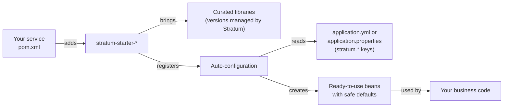

<div align="center">

# Stratum

**The standard foundation for building microservices on Spring Boot and Java 25.**

Add a starter. Set a few properties. Write only business code.


[Documentation](docs/README.md) ·
[Quick start](#quick-start) ·
[Modules](#modules) ·
[Configuration](#configuration-yaml-or-properties) ·
[FAQ](docs/guides/faq.md)

</div>

---

> [!IMPORTANT]
> **Stratum is in the design stage.** This README and the [documentation](docs/README.md) describe what
> Stratum will do once it is built. No module is released yet. Everything marked **Planned** is the
> design target and may change. The Maven `groupId` is `com.exepex.stratum`; the version
> `0.1.0-SNAPSHOT` in the examples is a **placeholder** until the first release.

## Table of contents

- [What is Stratum?](#what-is-stratum)
- [Why Stratum exists](#why-stratum-exists)
- [How it works](#how-it-works)
- [What you get](#what-you-get)
- [Quick start](#quick-start)
- [Modules](#modules)
- [Configuration: YAML or properties](#configuration-yaml-or-properties)
- [Changing or switching off a default](#changing-or-switching-off-a-default)
- [Using Stratum with your company's framework](#using-stratum-with-your-companys-framework)
- [Testing your service](#testing-your-service)
- [Upgrades and versions](#upgrades-and-versions)
- [Documentation map](#documentation-map)
- [Building Stratum](#building-stratum)
- [Contributing](#contributing)
- [License](#license)

## What is Stratum?

Stratum is an **SDK** (a software development kit: a set of ready-made libraries) that sits between
Spring Boot and your business services.

```text
┌──────────────────────────────────────────────────────────────┐
│   Your business services: orders, payments, inventory, ...   │  ← you write this
├──────────────────────────────────────────────────────────────┤
│   Stratum: logging, tracing, metrics, security, HTTP and     │  ← Stratum provides this,
│   OAuth2 clients, resilience, data, cache, messaging, tests  │    the same in every service
├──────────────────────────────────────────────────────────────┤
│   Spring Boot 4.1  ·  Spring Framework 7  ·  Java 25         │  ← the platform underneath
└──────────────────────────────────────────────────────────────┘
```

Every microservice needs the same building blocks: logs that the whole platform can search, traces
that follow a request across services, metrics, health checks, token validation, HTTP clients with
timeouts and retries, database and cache setup, and a way to test all of this. Stratum provides
these building blocks once, already configured and tested, so every service gets them the same way.

You keep writing normal Spring Boot code. Stratum does not replace Spring; it configures Spring for
you, following one agreed standard.

## Why Stratum exists

Spring Boot is mature and fast to build with, but it is a **general-purpose** framework. It supports
many ways of doing the same thing. That freedom costs every team time:

| The problem | What it looks like in practice |
| --- | --- |
| **Too many choices** | Which HTTP client? Which log format? Which tracing exporter? Which of the many Spring modules? |
| **Configuration is hard to remember** | Bean definitions, property names and auto-configuration rules are easy to get wrong. Developers search the web or ask an AI assistant, and still miss a timeout or a security setting. |
| **Services drift apart** | Each team wires logging, trace headers, error responses and client timeouts its own way. Operating, debugging and securing the platform gets harder with every service. |
| **Upgrades are repeated everywhere** | Every service researches and performs the same Spring Boot and library upgrades on its own. |
| **Test setup is rebuilt in each repo** | Each team re-creates database containers, HTTP stubs and security test helpers. |

Stratum answers these questions **once**, centrally. Business teams extend Stratum and spend their
time on the business problem.

## How it works

Stratum is a set of **starters**. A starter is one Maven dependency that brings the libraries for one
concern together with their configuration. When your service starts, Spring Boot's
**auto-configuration** (the mechanism that creates beans for you based on what is on the classpath)
finds each Stratum starter and sets it up.



Four rules shape every module:

1. **Works with zero configuration.** Each starter has safe, production-ready defaults. You set only
   what is specific to your service, such as the URL of a service you call.
2. **Opt-in.** You add only the starters you need. A service that never calls another service does
   not carry an HTTP client.
3. **Never locked in.** Every bean Stratum creates steps aside when you define your own, and every
   default is a property you can change. See [Overriding defaults](docs/configuration/overriding-defaults.md).
4. **Plain Spring underneath.** Anything you know about Spring Boot still applies. Stratum builds on
   Spring's own extension points and adds no proprietary programming model.

New to these terms? Read [Core concepts](docs/getting-started/concepts.md) first. It explains starters,
beans, auto-configuration, properties and profiles from the beginning.

## What you get

| Concern | Without Stratum | With Stratum |
| --- | --- | --- |
| Logging | Each service picks a format | Structured JSON logs with trace and correlation IDs, secrets redacted |
| Tracing | Trace headers lost between services | Traces follow every request across HTTP calls and Kafka messages |
| Metrics and health | Hand-picked endpoints and tags | Standard metrics, tags, health and Kubernetes probes |
| Errors | Different error bodies per service | One error format (RFC 9457 Problem Details) everywhere |
| Security | Copied `SecurityFilterChain` code | JWT validation and secure defaults from a few properties |
| Calling other services | Clients without timeouts | HTTP clients with timeouts, retries, tracing and tokens |
| Resilience | Retry loops written by hand | Named retry, circuit breaker and bulkhead policies |
| Data and cache | Pool and cache settings guessed | Tuned connection pool, migrations, auditing, caches with TTLs |
| Messaging | Custom error handling per consumer | Kafka with retries, dead-letter topics and trace propagation |
| Testing | Containers and stubs rebuilt per repo | Shared Testcontainers, HTTP stubs and security test helpers |
| Upgrades | Every service upgrades alone | One Stratum version bump upgrades the whole stack |

## Quick start

This is the short version. The [Quick start guide](docs/getting-started/quick-start.md) walks through
every step and explains each line.

**You need:** JDK 25 and Maven 3.9 or later.

**1. Use Stratum as the parent of your service's `pom.xml`:**

```xml
<parent>
  <groupId>com.exepex.stratum</groupId>
  <artifactId>stratum-parent</artifactId>
  <version>0.1.0-SNAPSHOT</version>
</parent>
```

Your service already has a parent, such as your company's? Import the Stratum BOM instead. See
[Installation](docs/getting-started/installation.md).

**2. Add the starters you need.** No `<version>` tags: Stratum manages them. This example uses
three single starters. For a whole application, add a [bundle](#bundles) instead, and switch on
each module it brings.

```xml
<dependencies>
  <dependency>
    <groupId>com.exepex.stratum</groupId>
    <artifactId>stratum-starter-web</artifactId>
  </dependency>
  <dependency>
    <groupId>com.exepex.stratum</groupId>
    <artifactId>stratum-starter-logging</artifactId>
  </dependency>
  <dependency>
    <groupId>com.exepex.stratum</groupId>
    <artifactId>stratum-starter-observability</artifactId>
  </dependency>
  <dependency>
    <groupId>com.exepex.stratum</groupId>
    <artifactId>stratum-test</artifactId>
    <scope>test</scope>
  </dependency>
</dependencies>
```

**3. Name your service and switch on the modules you use** in `application.yml` (or
`application.properties`). Every module is off until you switch it on:

```yaml
spring:
  application:
    name: order-service
stratum:
  web:
    enabled: true
  logging:
    enabled: true
  observability:
    enabled: true
```

```properties
spring.application.name=order-service
stratum.web.enabled=true
stratum.logging.enabled=true
stratum.observability.enabled=true
```

**4. Write a controller** and run `mvn spring-boot:run`:

```java
@RestController
class HelloController {

  @GetMapping("/hello")
  String hello() {
    return "Hello from Stratum";
  }
}
```

With only these lines your service already has JSON logs with trace IDs, metrics, health probes at
`/actuator/health/liveness` and `/actuator/health/readiness`, correlation IDs on every request and
standard error responses.

## Modules

All modules are **Planned**. Each links to its full page: what it sets up, every property with its
default, examples in YAML and properties, how to override it and how to troubleshoot it.

### Build and platform

| Module | In one sentence |
| --- | --- |
| [`stratum-parent`](docs/modules/parent-and-bom.md) | Parent POM: Java 25, plugin versions and the quality gates every service build runs. |
| [`stratum-bom`](docs/modules/parent-and-bom.md#the-bom) | Bill of materials (BOM): one list of tested versions, for services that keep their own parent. |

### Bundles

One dependency per kind of application; each lists only the single starters that kind needs. See
[Bundle starters](docs/modules/bundles.md).

A bundle with `security` puts Spring Security on the classpath. Until you switch on
`stratum.security.enabled` and set its issuer, Spring Boot's default applies and every endpoint
asks for a login. See [Security](docs/modules/security.md).

| Bundle | Single starters it adds |
| --- | --- |
| `stratum-starter-microservice` | web, logging, observability, http-client, resilience, security |
| `stratum-starter-web-ui` | web, logging, observability, security |
| `stratum-starter-batch` | data-jpa, logging, observability |
| `stratum-starter-cli` | logging |

### Starters

Every starter is off until its `stratum.<module>.enabled` property is `true`.

| Starter | In one sentence | Property prefix |
| --- | --- | --- |
| [`stratum-starter-web`](docs/modules/web.md) | REST defaults: error format, correlation IDs, request logging, JSON settings. | `stratum.web` |
| [`stratum-starter-logging`](docs/modules/logging.md) | Structured JSON logs with trace context and secret redaction. | `stratum.logging` |
| [`stratum-starter-observability`](docs/modules/observability.md) | Metrics, OpenTelemetry tracing, health and Kubernetes probes. | `stratum.observability` |
| [`stratum-starter-security`](docs/modules/security.md) | OAuth2 resource server: JWT validation, roles, public paths, CORS. | `stratum.security` |
| [`stratum-starter-oauth2-client`](docs/modules/oauth2-client.md) | Gets and refreshes tokens for calls to other services. | `stratum.oauth2-client` |
| [`stratum-starter-http-client`](docs/modules/http-client.md) | Declarative HTTP clients with timeouts, tracing, tokens and retries. | `stratum.http-client` |
| [`stratum-starter-resilience`](docs/modules/resilience.md) | Named retry, circuit breaker, bulkhead and time limit policies. | `stratum.resilience` |
| [`stratum-starter-data-jpa`](docs/modules/data-jpa.md) | Connection pool, JPA defaults, Flyway migrations, auditing. | `stratum.data` |
| [`stratum-starter-cache`](docs/modules/cache.md) | Caffeine or Redis caching with per-cache TTL and size. | `stratum.cache` |
| [`stratum-starter-kafka`](docs/modules/kafka.md) | Kafka producers and consumers with retries and dead-letter topics. | `stratum.kafka` |
| [`stratum-starter-cloud-*`](docs/modules/cloud.md) | Cloud services such as storage, queues and secrets, per provider. | `stratum.cloud` |

### Testing

| Module | In one sentence |
| --- | --- |
| [`stratum-test`](docs/modules/test.md) | JUnit 5, AssertJ, Mockito, Testcontainers, HTTP stubs and JWT helpers, ready to use. |

## Configuration: YAML or properties

Stratum works with **both** `application.yml` and `application.properties`, and with every other
source Spring Boot supports: profile files, environment variables, command-line arguments and config
servers. Use the format your team prefers. Every example in the documentation shows both.

The same setting, three ways:

```yaml
# application.yml
stratum:
  http-client:
    clients:
      inventory:
        base-url: https://inventory.internal
        read-timeout: 3s
```

```properties
# application.properties
stratum.http-client.clients.inventory.base-url=https://inventory.internal
stratum.http-client.clients.inventory.read-timeout=3s
```

```bash
# Environment variables (for example in Kubernetes)
STRATUM_HTTPCLIENT_CLIENTS_INVENTORY_BASEURL=https://inventory.internal
STRATUM_HTTPCLIENT_CLIENTS_INVENTORY_READTIMEOUT=3s
```

Things worth knowing from day one:

- **All Stratum settings start with `stratum.`** followed by the module name, for example
  `stratum.logging.format`. Your IDE completes them, because each module ships configuration metadata.
- **A wrong value fails at startup**, with a message naming the property, not at the first request.
- **What you set always wins** over Stratum's defaults. Stratum's defaults have the lowest priority.
- **Spring Boot's own properties still work.** For example `logging.level.*` and `server.port`.
- **Secrets never go in these files.** Use environment variables or a secret store.

Read more:
[Configuration basics](docs/configuration/basics.md) ·
[Profiles and environments](docs/configuration/profiles-and-environments.md) ·
[All `stratum.*` properties](docs/configuration/reference.md)

## Changing or switching off a default

You stay in control at three levels, from lightest to strongest:

| You want to | Do this | Example |
| --- | --- | --- |
| Change a value | Set a property | `stratum.http-client.defaults.read-timeout=10s` |
| Adjust a bean Stratum created | Declare a customizer bean | A `RestClientCustomizer` that adds a header |
| Replace a bean entirely | Declare your own bean of the same type | Your own `SecurityFilterChain` |
| Switch a whole module on or off | Set `enabled`; every module is off until set to `true` | `stratum.cache.enabled=true` |

Details and examples: [Overriding defaults](docs/configuration/overriding-defaults.md).

## Using Stratum with your company's framework

Your company may already have its own framework on Spring Boot: a parent POM that every service
inherits, and starters with the company's own beans. Stratum is designed to work next to it, not
against it. There are three setups:

| Setup | Parent chain | When to use it |
| --- | --- | --- |
| A: Stratum as parent | Spring Boot → `stratum-parent` → service | There is no company framework |
| B: company parent, Stratum BOM | Spring Boot → company parent → service, importing `stratum-bom` | **Recommended** when a company framework exists |
| C: team fork of Stratum | Spring Boot → company parent → forked `stratum-parent` → service | Supported, when a team wants one parent and accepts merging every Stratum release into its fork |

In setups B and C three rules keep the two frameworks from conflicting:

- **One Spring Boot version, set by the parent.** `stratum-bom` does not set Spring Boot's versions.
  The company parent's Spring Boot version must be in the line Stratum supports, which the
  [compatibility table](docs/guides/upgrading.md#compatibility) lists.
- **The company's bean wins.** Stratum's beans are created only when no bean of the same type exists,
  and Stratum's auto-configurations usually run after the company's. The exceptions, and what to do
  about them, are in
  [Rule 2 of the guide](docs/guides/company-framework.md#rule-2-the-companys-bean-wins).
- **Overlapping setups stay off.** Every Stratum module is off until the service switches it on.
  Where both frameworks set up a whole concern, such as a security filter chain or the log format,
  the service keeps the company's and leaves Stratum's off, or excludes that starter.

Step-by-step setup and configuration: [Using Stratum with a company framework](docs/guides/company-framework.md).
The decision behind it: [ADR 0001](docs/adr/0001-coexistence-with-company-frameworks.md).

## Testing your service

`stratum-test` gives you everything you need for unit, mock and integration tests in one test
dependency:

- **Unit tests** (`*Test.java`) with JUnit 5, AssertJ and Mockito.
- **Integration tests** (`*IT.java`) that start a real PostgreSQL, Kafka or Redis in Docker with
  Testcontainers. Image versions are pinned centrally, so every service tests against the same ones.
- **HTTP stubs** for the services you call, so tests never depend on a real downstream service.
- **Security helpers** to call secured endpoints with a test JWT.

```java
@StratumIntegrationTest
class OrderApiIT {

  @Test
  void createsAnOrder(@Autowired MockMvcTester mvc) {
    assertThat(mvc.post().uri("/orders").with(stratumJwt("orders:write"))
            .contentType(APPLICATION_JSON).content("{\"sku\":\"A-1\",\"quantity\":2}"))
        .hasStatus(HttpStatus.CREATED);
  }
}
```

Full guide: [Testing with stratum-test](docs/modules/test.md).

## Upgrades and versions

| Component | Version in Stratum 0.1 (planned) |
| --- | --- |
| Java | 25 |
| Spring Boot | 4.1.2, the latest stable release on 27 October 2026 |
| Spring Framework | 7.x, managed by Spring Boot |
| Maven | 3.9 or later |

- Stratum follows [semantic versioning](https://semver.org): a patch release never breaks you; a major
  release may, and its release notes list the exact migration steps.
- Each Stratum release supports one Spring Boot line, such as `4.1.x`, and is tested with one release
  in it. With `stratum-parent`, upgrading Stratum upgrades Spring Boot and every managed library
  together. Under a company parent, the company parent sets the Spring Boot version, and Stratum
  checks at startup that it supports it.

Details: [Versioning and upgrades](docs/guides/upgrading.md).

## Documentation map

The full documentation lives in [`docs/`](docs/README.md). Start with the page that matches you:

| I am... | Start here |
| --- | --- |
| New to Spring Boot | [Core concepts](docs/getting-started/concepts.md), then [Quick start](docs/getting-started/quick-start.md) |
| Starting a new service | [Quick start](docs/getting-started/quick-start.md) |
| Moving an existing service to Stratum | [Installation](docs/getting-started/installation.md) and [Migrating a service](docs/guides/migrating-a-service.md) |
| Keeping my company's framework | [Using Stratum with a company framework](docs/guides/company-framework.md) |
| Looking for a property | [Configuration reference](docs/configuration/reference.md) |
| Using one component | Its page under [Modules](#modules) |
| Debugging a startup or config problem | [Troubleshooting](docs/guides/troubleshooting.md) |
| Curious how Stratum is built | [Architecture](docs/guides/architecture.md) |
| Contributing to Stratum | [Contributing guide](docs/contributing.md) |

## Building Stratum

You need JDK 25. The Maven Wrapper (`./mvnw`, or `mvnw.cmd` on Windows) downloads the Maven
version the build is tested with.

```bash
git clone https://github.com/exepex/stratum.git
cd stratum
./mvnw verify
```

`./mvnw verify` checks formatting, runs Checkstyle, PMD, SpotBugs and the Maven Enforcer, runs unit
and integration tests (Docker will be needed once integration tests use containers) and fails if
line coverage drops below 80%. The modules are grouped into `platform/` (BOM, parent POMs and build
rules), `libs/` (shared libraries) and `starters/`; see
[Architecture](docs/guides/architecture.md#repository-layout).

Every pull request runs the same build, plus an SBOM and a vulnerability scan of it, in GitHub
Actions; see
[Checks on every pull request](docs/contributing.md#checks-on-every-pull-request).

## Contributing

Contributions are welcome. Read the [contributing guide](docs/contributing.md) before you start. It
explains when a new starter makes sense and what every starter must include. Agents and humans
follow the same rules in [`AGENTS.md`](AGENTS.md).

## License

Stratum is licensed under the [Apache License 2.0](LICENSE).
