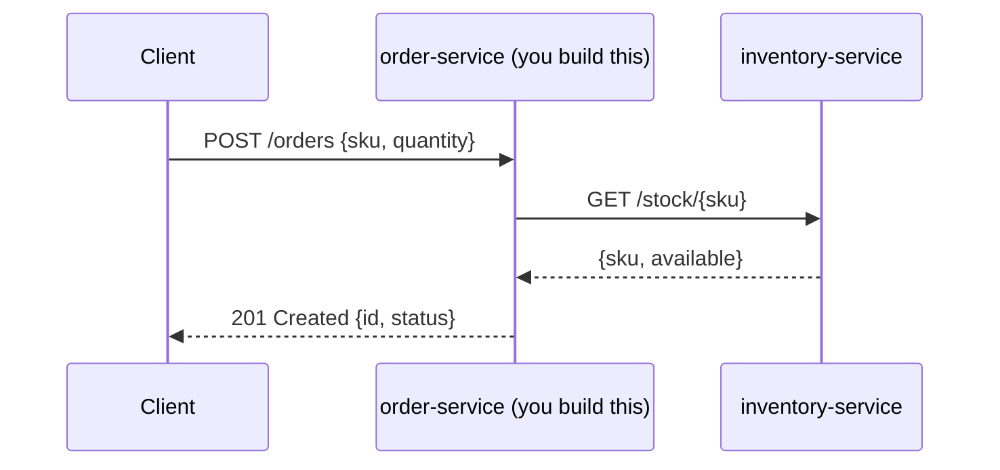

# Quick start: build your first Stratum service

**Status: Planned.** In this guide you build a small `order-service` that exposes a REST API, calls an
`inventory-service`, and has unit and integration tests. Each step explains what Stratum does for
you, so you know what is happening behind the scenes.

Time: about 20 minutes. [← Documentation home](../README.md)

> **Add the starter, and its module is on.** A Stratum starter sets up its module as soon as it is
> on the classpath; you write no line to switch it on. To keep one off, set
> `stratum.<module>.enabled=false`. The service then logs one line at startup naming each module
> turned off, such as `Stratum modules present but off: web (stratum.web.enabled=false)`.

## What you will build



## Step 1: create the project

Create this layout (or generate a plain Maven project with your IDE):

```text
order-service/
├── pom.xml
└── src/
    ├── main/
    │   ├── java/com/acme/orders/
    │   └── resources/application.yml
    └── test/java/com/acme/orders/
```

`pom.xml`:

```xml
<project>
  <modelVersion>4.0.0</modelVersion>

  <parent>
    <groupId>io.github.exepex.stratum</groupId>
    <artifactId>stratum-microservice-parent</artifactId>
    <version>0.1.0-SNAPSHOT</version>
    <relativePath/>
  </parent>

  <groupId>com.acme.orders</groupId>
  <artifactId>order-service</artifactId>
  <version>1.0.0-SNAPSHOT</version>
</project>
```

**What Stratum did:** the parent set Java 25, every plugin version and the quality checks. It also
brought the [microservice bundle](../modules/bundles.md), whose starters bring Spring MVC, Actuator,
Micrometer, OpenTelemetry, structured logging, an HTTP client library and caching, and the test
libraries, all at versions tested together.

## Step 2: the application class

`src/main/java/com/acme/orders/OrderServiceApplication.java`:

```java
package com.acme.orders;

import org.springframework.boot.SpringApplication;
import org.springframework.boot.autoconfigure.SpringBootApplication;

@SpringBootApplication
public class OrderServiceApplication {

  public static void main(String[] args) {
    SpringApplication.run(OrderServiceApplication.class, args);
  }
}
```

Nothing Stratum-specific: Stratum is switched on by its starters, not by an annotation.

## Step 3: configuration

`src/main/resources/application.yml`:

```yaml
spring:
  application:
    name: order-service

stratum:
  http-client:
    clients:
      inventory:
        url: http://localhost:8081
        timeout: 2s
```

The same in `src/main/resources/application.properties` (use one file, not both):

```properties
spring.application.name=order-service
stratum.http-client.clients.inventory.url=http://localhost:8081
stratum.http-client.clients.inventory.timeout=2s
```

The observability module also needs your OpenTelemetry Collector's addresses, in
every profile, or it stops at startup. To try it without a Collector, point both at `localhost`
(`http://localhost:4318/v1/metrics` and `http://localhost:4318/v1/traces`), and the data is dropped
without a failed-send log ([Observability](../../starters/stratum-starter-observability/README.md#running-without-a-collector)).

**What Stratum did:** it switched on the four modules (each is on because its starter is on the
classpath) and set up the `inventory` client as its own HTTP service group, with its own connection
pool. Everything you did not set (connect timeout, pool size, wait for a free connection) uses
Stratum's defaults. See [HTTP client](../modules/http-client.md#properties).

Every error gets Stratum's standard body and every request the standard time and body size limits,
because `stratum.backward-compatible` is `false` by default. A new service leaves it unset, because
it has no consumers that read an older error body. A running service that adds Stratum sets it to
`true` until its consumers have moved; see
[Backward-compatible mode](../modules/web-compatible-mode.md).

## Step 4: declare the downstream client

You describe the remote API as a Java interface with `@StratumClient("inventory")`. Spring generates
the implementation, and Stratum finds the interface by scanning and configures it from the
`inventory` block above ([HTTP client](../modules/http-client.md#use-it)).

`src/main/java/com/acme/orders/inventory/InventoryClient.java`:

```java
package com.acme.orders.inventory;

import com.exepex.stratum.httpclient.StratumClient;
import org.springframework.web.bind.annotation.PathVariable;
import org.springframework.web.service.annotation.GetExchange;

@StratumClient("inventory")
public interface InventoryClient {

  @GetExchange("/stock/{sku}")
  Stock stockFor(@PathVariable String sku);

  record Stock(String sku, int available) {}
}
```

No other registration is needed.

## Step 5: business code

`src/main/java/com/acme/orders/OrderController.java`:

```java
package com.acme.orders;

import com.acme.orders.inventory.InventoryClient;
import jakarta.validation.Valid;
import jakarta.validation.constraints.NotBlank;
import jakarta.validation.constraints.Positive;
import java.util.UUID;
import org.springframework.http.HttpStatus;
import org.springframework.web.bind.annotation.*;

@RestController
@RequestMapping("/orders")
class OrderController {

  private final InventoryClient inventory;

  OrderController(InventoryClient inventory) {
    this.inventory = inventory;
  }

  @PostMapping
  @ResponseStatus(HttpStatus.CREATED)
  OrderView create(@RequestBody @Valid CreateOrder request) {
    var stock = inventory.stockFor(request.sku());
    if (stock.available() < request.quantity()) {
      throw new OutOfStockException(request.sku());
    }
    return new OrderView(UUID.randomUUID().toString(), "ACCEPTED");
  }

  record CreateOrder(@NotBlank String sku, @Positive int quantity) {}

  record OrderView(String id, String status) {}
}
```

`OutOfStockException.java`:

```java
@ResponseStatus(HttpStatus.CONFLICT)
class OutOfStockException extends RuntimeException {

  OutOfStockException(String sku) {
    super("Not enough stock for " + sku);
  }
}
```

**What Stratum did for this code, with no extra lines:**

| You get | Because of |
| --- | --- |
| Invalid input returns `400` with a list of field errors | `stratum-starter-webmvc` validation and error handling |
| `OutOfStockException` returns `409` as Problem Details JSON | `stratum-starter-webmvc` error handling |
| Every log line written inside a traced operation carries `traceId`, `spanId` and `correlationId` | `stratum-starter-observability`, written as JSON by `stratum-starter-logging` |
| The call to inventory carries the trace and correlation headers (`trace-headers`, on by default) | `stratum-starter-http-client` |
| The call to inventory times out after 2 s instead of hanging | Your `timeout` plus Stratum's connect timeout |
| `http.server.requests` and `http.client.requests` metrics | `stratum-starter-observability` |

## Step 6: run it

```bash
mvn spring-boot:run
```

Try it (with no inventory service running, so you can see the error format):

```bash
curl -i -X POST localhost:8080/orders \
  -H 'Content-Type: application/json' \
  -d '{"sku":"A-1","quantity":2}'
```

You get Stratum's standard error body, because `stratum.backward-compatible` is `false` by default:

```json
{
  "type": "about:blank",
  "title": "Service Unavailable",
  "status": 503,
  "detail": "Downstream service 'inventory' is not reachable",
  "instance": "/orders",
  "traceId": "4bf92f3577b34da6a3ce929d0e0e4736",
  "correlationId": "c0a8012e-7f3d-4a8e-9a43-2f9b6f1c2d10"
}
```

Copy the `traceId` into your tracing tool, or search your logs for it, to see everything that happened
in this request.

## Step 7: test it

`src/test/java/com/acme/orders/OrderApiIntegrationTest.java`:

```java
package com.acme.orders;

@SpringBootTest
@AutoConfigureMockMvc
class OrderApiIntegrationTest {

  @Autowired MockMvcTester mvc;
  @MockitoBean InventoryClient inventory;   // stands in for the inventory service

  @Test
  void acceptsAnOrderWhenStockIsAvailable() {
    when(inventory.stockFor("A-1")).thenReturn(new InventoryClient.Stock("A-1", 5));

    assertThat(mvc.post().uri("/orders").contentType(APPLICATION_JSON)
            .content("{\"sku\":\"A-1\",\"quantity\":2}"))
        .hasStatus(HttpStatus.CREATED);
  }

  @Test
  void rejectsAnOrderWhenStockIsShort() {
    when(inventory.stockFor("A-1")).thenReturn(new InventoryClient.Stock("A-1", 1));

    assertThat(mvc.post().uri("/orders").contentType(APPLICATION_JSON)
            .content("{\"sku\":\"A-1\",\"quantity\":2}"))
        .hasStatus(HttpStatus.CONFLICT);
  }
}
```

Run all tests:

```bash
mvn verify
```

Unit tests (`*Test.java`) run in the `test` phase; integration tests (`*IntegrationTest.java`) run in the
`integration-test` phase. See [Testing with stratum-test](../modules/test.md).

## What to read next

- Add token validation to your API: [Security](../modules/security.md)
- Tune the retries and circuit breaker of the inventory call: [HTTP client: retries and the circuit breaker](../modules/http-client-resilience.md)
- Configure per environment: [Profiles and environments](../configuration/profiles-and-environments.md)
- Change any default: [Overriding defaults](../configuration/overriding-defaults.md)
