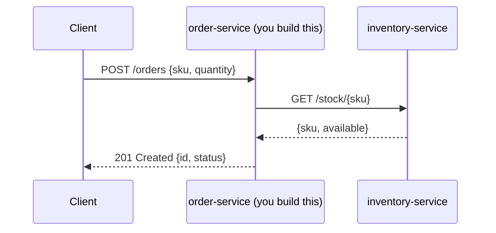

# Quick start: build your first Stratum service

**Status: Planned.** In this guide you build a small `order-service` that exposes a REST API, calls an
`inventory-service`, and has unit and integration tests. Each step explains what Stratum does for
you, so you know what is happening behind the scenes.

Time: about 20 minutes. [← Documentation home](../README.md)

## What you will build



## Step 1: create the project

Create this layout (or generate a plain Maven project with your IDE):

```text
order-service/
├── pom.xml
└── src/
    ├── main/
    │   ├── java/com/acme/orders/
    │   └── resources/application.yml
    └── test/java/com/acme/orders/
```

`pom.xml`:

```xml
<project>
  <modelVersion>4.0.0</modelVersion>

  <parent>
    <groupId>com.exepex.stratum</groupId>
    <artifactId>stratum-parent</artifactId>
    <version>0.1.0-SNAPSHOT</version>
    <relativePath/>
  </parent>

  <groupId>com.acme.orders</groupId>
  <artifactId>order-service</artifactId>
  <version>1.0.0-SNAPSHOT</version>

  <dependencies>
    <dependency>
      <groupId>com.exepex.stratum</groupId>
      <artifactId>stratum-starter-web</artifactId>
    </dependency>
    <dependency>
      <groupId>com.exepex.stratum</groupId>
      <artifactId>stratum-starter-logging</artifactId>
    </dependency>
    <dependency>
      <groupId>com.exepex.stratum</groupId>
      <artifactId>stratum-starter-observability</artifactId>
    </dependency>
    <dependency>
      <groupId>com.exepex.stratum</groupId>
      <artifactId>stratum-starter-http-client</artifactId>
    </dependency>
    <dependency>
      <groupId>com.exepex.stratum</groupId>
      <artifactId>stratum-test</artifactId>
      <scope>test</scope>
    </dependency>
  </dependencies>
</project>
```

**What Stratum did:** the parent set Java 25, every plugin version and the quality checks. The
starters brought Spring MVC, Actuator, Micrometer, OpenTelemetry, structured logging and an HTTP
client library, all at versions tested together.

## Step 2: the application class

`src/main/java/com/acme/orders/OrderServiceApplication.java`:

```java
package com.acme.orders;

import org.springframework.boot.SpringApplication;
import org.springframework.boot.autoconfigure.SpringBootApplication;

@SpringBootApplication
public class OrderServiceApplication {

  public static void main(String[] args) {
    SpringApplication.run(OrderServiceApplication.class, args);
  }
}
```

Nothing Stratum-specific: Stratum is switched on by its starters, not by an annotation.

## Step 3: configuration

`src/main/resources/application.yml`:

```yaml
spring:
  application:
    name: order-service

stratum:
  http-client:
    clients:
      inventory:
        base-url: http://localhost:8081
        read-timeout: 2s
```

The same in `src/main/resources/application.properties` (use one file, not both):

```properties
spring.application.name=order-service
stratum.http-client.clients.inventory.base-url=http://localhost:8081
stratum.http-client.clients.inventory.read-timeout=2s
```

**What Stratum did:** it registered an HTTP client group named `inventory`. Everything you did not
set (connect timeout, trace propagation, correlation header, logging) uses Stratum's defaults. See
[HTTP client](../modules/http-client.md#properties).

## Step 4: declare the downstream client

You describe the remote API as a Java interface. Spring generates the implementation, and Stratum
configures it.

`src/main/java/com/acme/orders/inventory/InventoryClient.java`:

```java
package com.acme.orders.inventory;

import org.springframework.web.bind.annotation.PathVariable;
import org.springframework.web.service.annotation.GetExchange;

public interface InventoryClient {

  @GetExchange("/stock/{sku}")
  Stock stockFor(@PathVariable String sku);

  record Stock(String sku, int available) {}
}
```

Register it under the `inventory` group, for example on the application class:

```java
@SpringBootApplication
@ImportHttpServices(group = "inventory", types = InventoryClient.class)
public class OrderServiceApplication { ... }
```

## Step 5: business code

`src/main/java/com/acme/orders/OrderController.java`:

```java
package com.acme.orders;

import com.acme.orders.inventory.InventoryClient;
import jakarta.validation.Valid;
import jakarta.validation.constraints.NotBlank;
import jakarta.validation.constraints.Positive;
import java.util.UUID;
import org.springframework.http.HttpStatus;
import org.springframework.web.bind.annotation.*;

@RestController
@RequestMapping("/orders")
class OrderController {

  private final InventoryClient inventory;

  OrderController(InventoryClient inventory) {
    this.inventory = inventory;
  }

  @PostMapping
  @ResponseStatus(HttpStatus.CREATED)
  OrderView create(@RequestBody @Valid CreateOrder request) {
    var stock = inventory.stockFor(request.sku());
    if (stock.available() < request.quantity()) {
      throw new OutOfStockException(request.sku());
    }
    return new OrderView(UUID.randomUUID().toString(), "ACCEPTED");
  }

  record CreateOrder(@NotBlank String sku, @Positive int quantity) {}

  record OrderView(String id, String status) {}
}
```

`OutOfStockException.java`:

```java
@ResponseStatus(HttpStatus.CONFLICT)
class OutOfStockException extends RuntimeException {

  OutOfStockException(String sku) {
    super("Not enough stock for " + sku);
  }
}
```

**What Stratum did for this code, with no extra lines:**

| You get | Because of |
| --- | --- |
| Invalid input returns `400` with a list of field errors | `stratum-starter-web` validation and error handling |
| `OutOfStockException` returns `409` as Problem Details JSON | `stratum-starter-web` error handling |
| Every log line carries `trace.id`, `span.id` and `correlation_id` | `stratum-starter-logging` |
| The call to inventory carries the trace and correlation headers | `stratum-starter-http-client` |
| The call to inventory times out after 2 s instead of hanging | Your `read-timeout` plus Stratum's connect timeout |
| `http.server.requests` and `http.client.requests` metrics | `stratum-starter-observability` |

## Step 6: run it

```bash
mvn spring-boot:run
```

Try it (with no inventory service running, so you can see the error format):

```bash
curl -i -X POST localhost:8080/orders \
  -H 'Content-Type: application/json' \
  -d '{"sku":"A-1","quantity":2}'
```

You get a standard error body, the same one every Stratum service returns:

```json
{
  "type": "about:blank",
  "title": "Service Unavailable",
  "status": 503,
  "detail": "Downstream service 'inventory' is not reachable",
  "instance": "/orders",
  "traceId": "4bf92f3577b34da6a3ce929d0e0e4736",
  "correlationId": "c0a8012e-7f3d-4a8e-9a43-2f9b6f1c2d10"
}
```

Copy the `traceId` into your tracing tool, or search your logs for it, to see everything that happened
in this request.

## Step 7: test it

`src/test/java/com/acme/orders/OrderApiIT.java`:

```java
package com.acme.orders;

@StratumIntegrationTest
@StubHttpClient("inventory")              // replaces inventory with a local HTTP stub
class OrderApiIT {

  @Autowired MockMvcTester mvc;
  @Autowired HttpStub inventory;

  @Test
  void acceptsAnOrderWhenStockIsAvailable() {
    inventory.stubGet("/stock/A-1", """
        {"sku":"A-1","available":5}""");

    assertThat(mvc.post().uri("/orders").contentType(APPLICATION_JSON)
            .content("{\"sku\":\"A-1\",\"quantity\":2}"))
        .hasStatus(HttpStatus.CREATED);
  }

  @Test
  void rejectsAnOrderWhenStockIsShort() {
    inventory.stubGet("/stock/A-1", """
        {"sku":"A-1","available":1}""");

    assertThat(mvc.post().uri("/orders").contentType(APPLICATION_JSON)
            .content("{\"sku\":\"A-1\",\"quantity\":2}"))
        .hasStatus(HttpStatus.CONFLICT);
  }
}
```

Run all tests:

```bash
mvn verify
```

Unit tests (`*Test.java`) run in the `test` phase; integration tests (`*IT.java`) run in the
`integration-test` phase. See [Testing with stratum-test](../modules/test.md).

## What to read next

- Add token validation to your API: [Security](../modules/security.md)
- Add retries and a circuit breaker to the inventory call: [Resilience](../modules/resilience.md)
- Configure per environment: [Profiles and environments](../configuration/profiles-and-environments.md)
- Change any default: [Overriding defaults](../configuration/overriding-defaults.md)
