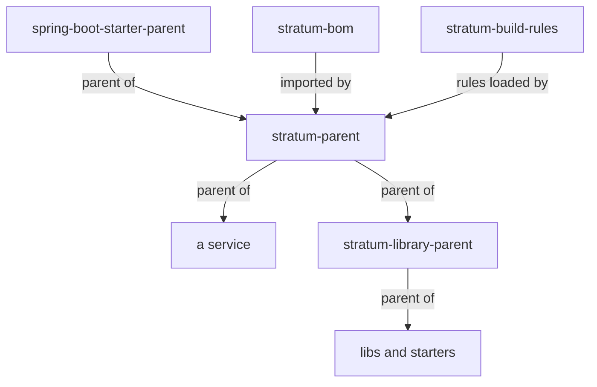
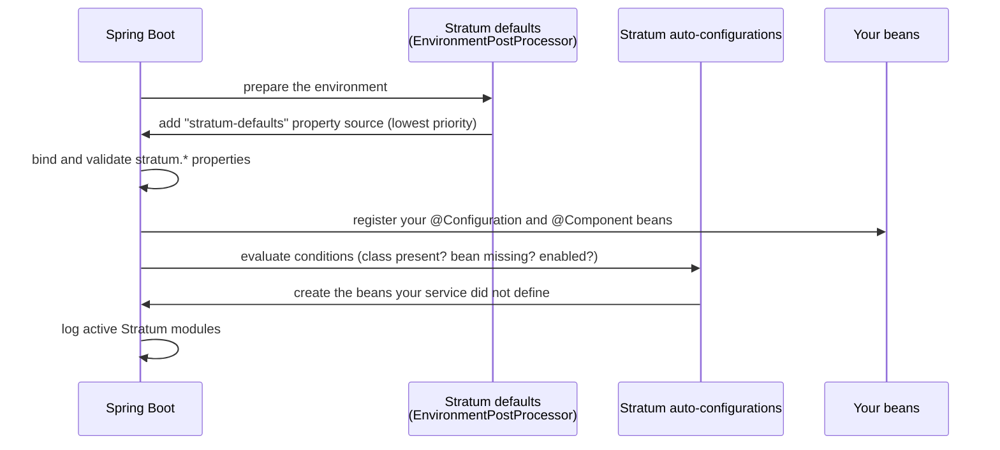

# Architecture

**Status: Planned, except the repository layout and the build, which exist.** How Stratum is built
inside. Useful if you contribute to Stratum, or want to understand exactly what happens when your
service starts.

[← Documentation home](../README.md)

## Design principles

| Principle | What it means in practice |
| --- | --- |
| **Convention over configuration** | Every module works with zero configuration and production-safe defaults. |
| **Opt-in** | One starter per concern; a service carries only what it uses. |
| **Never locked in** | Every bean is `@ConditionalOnMissingBean`; every default is a property; every module has an `enabled` switch. |
| **Plain Spring** | Stratum uses Spring Boot's auto-configuration and Spring's extension points. No custom programming model. |
| **Secure by default** | Secrets redacted, timeouts on every remote call, minimal Actuator exposure, validation of tokens. |
| **Fail fast** | Missing or invalid configuration stops startup with a clear message. |
| **Built for volume** | Bounded pools, queues and caches; no blocking on hot paths; retries only for idempotent operations. |
| **No business logic** | Stratum holds cross-cutting concerns only. |

## Repository layout

The build skeleton exists; the modules in it hold no code yet. The repository keeps three groups
apart: the platform (versions, build rules and parent POMs), the shared libraries, and the starters.

```text
stratum/
├── pom.xml                         # reactor: lists every module, builds them in order; nothing inherits it
├── platform/
│   ├── stratum-bom/                # versions of Stratum's modules and the extra libraries it uses
│   ├── stratum-build-rules/        # Checkstyle, PMD and Enforcer rules, packaged as a jar
│   ├── stratum-parent/             # parent POM for services: imports the BOM, sets every plugin version
│   └── stratum-library-parent/     # parent of the libraries and starters below
├── libs/
│   ├── stratum-core/               # shared internals: constants, property defaults, version check
│   └── stratum-test/               # test support for services
├── starters/
│   ├── stratum-starter-cache/
│   ├── stratum-starter-data-jpa/
│   ├── stratum-starter-http-client/
│   ├── stratum-starter-kafka/
│   ├── stratum-starter-logging/
│   ├── stratum-starter-oauth2-client/
│   ├── stratum-starter-observability/
│   ├── stratum-starter-resilience/
│   ├── stratum-starter-security/
│   └── stratum-starter-web/
└── docs/                           # this documentation
```

Planned, not in the repository yet: `starters/stratum-starter-cloud-<provider>/`, once the first
cloud provider is chosen, and `samples/`, small example services built and tested with Stratum.

### Where each version is set

| What | Set in | Rule |
| --- | --- | --- |
| Spring Boot and every library and plugin it manages | `spring-boot-starter-parent`, the parent of `stratum-parent` | Stratum never overrides these versions ([ADR 0001](../adr/0001-coexistence-with-company-frameworks.md)) |
| Stratum's modules and libraries Spring Boot does not manage | `platform/stratum-bom` | One `<dependencyManagement>` list, sorted by name |
| Plugins Spring Boot does not manage | `platform/stratum-parent`, in `<properties>` | One `*.version` property per plugin, sorted by name |

A module POM never writes a version for a dependency or a plugin.

### How the parents fit together



- `stratum-parent` is the parent services use. Every check it runs on a service also runs on
  Stratum's own code, so Stratum is held to the rules it gives its users.
- `stratum-library-parent` turns off what only applies to a service: the executable jar,
  `build-info.properties` and `git.properties`. A library jar that carried those two files would hide
  the service's own files from `/actuator/info`.
- `stratum-bom` and `stratum-build-rules` have no parent. The BOM must not inherit Spring Boot's
  versions, and `stratum-parent` loads the build rules, so the rules cannot inherit from it.

## Inside a starter

Every starter has the same shape:

```text
stratum-starter-http-client/
├── pom.xml
└── src/
    ├── main/
    │   ├── java/com/exepex/stratum/httpclient/
    │   │   ├── autoconfigure/                       # wiring only: @AutoConfiguration classes
    │   │   │   └── StratumHttpClientAutoConfiguration.java
    │   │   ├── StratumHttpClientProperties.java     # @ConfigurationProperties("stratum.http-client")
    │   │   └── ...                                  # behaviour, testable without Spring
    │   └── resources/META-INF/
    │       ├── spring/org.springframework.boot.autoconfigure.AutoConfiguration.imports
    │       └── additional-spring-configuration-metadata.json
    └── test/
```

- The **`autoconfigure` package only wires beans**. All behaviour lives in ordinary classes that can
  be unit tested without starting Spring.
- **Properties** are a typed `@ConfigurationProperties` class with validation and Javadoc on every
  field; the Javadoc becomes the description your IDE shows.
- Auto-configurations are registered in the `AutoConfiguration.imports` file (never by component
  scanning), with explicit ordering against Spring Boot's own. They sort after auto-configurations
  that declare no order, so a company framework's beans are created first and Stratum's back off
  (see [ADR 0001](../adr/0001-coexistence-with-company-frameworks.md)).

## What happens at startup



### How defaults are applied

Stratum puts its defaults for Spring Boot properties (for example `spring.jpa.open-in-view=false`)
into a property source with the **lowest** priority. Any value from your files, environment variables
or command line therefore overrides it, with no special syntax. The defaults of Stratum's own
`stratum.*` properties live in the properties classes themselves.

## How starters work together

Starters never import each other's internal classes. They cooperate through Spring and Micrometer's
public extension points:

| Collaboration | Mechanism |
| --- | --- |
| HTTP client sends trace headers | Spring's observation support on `RestClient`, configured by observability |
| Logs show trace IDs | Micrometer Tracing puts IDs in the MDC; logging writes them |
| Logs show correlation IDs | The web starter puts the ID in the MDC; logging writes it |
| HTTP client sends tokens | A request interceptor backed by Spring Security's `OAuth2AuthorizedClientManager` |
| HTTP client uses resilience policies | The resilience starter registers a customizer when present |
| Errors from HTTP clients become `503`/`504` | The web starter handles `DownstreamUnavailableException` from the shared core |

Shared names (header names, MDC keys, metric names) are constants in `stratum-core`, so every
module uses the same spelling.

## Architecture decisions

Significant decisions are recorded as ADRs (architecture decision records) in `docs/adr/`, numbered
in order. An accepted ADR is never edited; a new one replaces it. Decisions so far, and the ones
planned next:

| Topic | Status |
| --- | --- |
| [0001: Stratum next to a company framework](../adr/0001-coexistence-with-company-frameworks.md) | Accepted |
| Maven `groupId` and Java package names | Decided by the owner: `com.exepex.stratum`, and packages under `com.exepex.stratum` |
| Problem Details (RFC 9457) as the error format | Proposed |
| Resilience4j as the resilience engine | Proposed |
| First cloud provider | Open |
