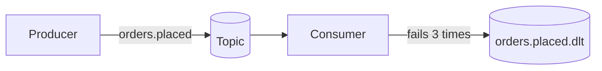

# Kafka: `stratum-starter-kafka`

**Status: Planned.** Kafka producers and consumers with JSON messages, safe producer settings,
retries, dead-letter topics and trace propagation.

[← Documentation home](../README.md) · Property prefix: `stratum.kafka`

## What it does

Kafka is easy to start with and easy to get wrong: a consumer that fails on one bad message can stop
a whole partition, a producer can lose messages with the wrong acknowledgement setting, and traces
end at the topic. This starter sets Spring for Apache Kafka up so that:

- producers do not lose or duplicate messages on retry,
- a failing message is retried a few times and then moved to a **dead-letter topic** (DLT), so the
  consumer keeps going and the message is kept for later,
- the trace continues from the producer to the consumer.



## Add it

```xml
<dependency>
  <groupId>com.exepex.stratum</groupId>
  <artifactId>stratum-starter-kafka</artifactId>
</dependency>
```

The starter does nothing until you switch it on, in `application.properties`:

```properties
stratum.kafka.enabled=true
```

or in `application.yml`:

```yaml
stratum:
  kafka:
    enabled: true
```

**Required:** `spring.kafka.bootstrap-servers`.

## Use it

Send:

```java
@Service
class OrderEvents {

  private final KafkaTemplate<String, OrderPlaced> kafka;

  OrderEvents(KafkaTemplate<String, OrderPlaced> kafka) {
    this.kafka = kafka;
  }

  void placed(Order order) {
    kafka.send("orders.placed", order.id(), new OrderPlaced(order.id(), order.total()));
  }
}
```

Receive:

```java
@Component
class ShippingListener {

  @KafkaListener(topics = "orders.placed")
  void on(OrderPlaced event) {
    shipping.prepare(event.orderId());
  }
}
```

Use the business key (here the order ID) as the message key, so all messages for one order go to the
same partition and are processed in order.

## What you get

| Feature | Behaviour |
| --- | --- |
| JSON messages | Records serialised as JSON; the consumer group defaults to `spring.application.name` |
| Safe producer | Idempotence on, `acks=all`, so a retry never writes a duplicate and an acknowledged write is not lost |
| Consumer retries | 3 attempts with growing backoff, then the message goes to `<topic>.dlt` |
| Not retried | Messages that cannot be deserialised, and exceptions you mark as not retryable, go to the DLT at once |
| Trace propagation | Trace context travels in message headers |
| Correlation ID | Copied into a message header and back into the consumer's log context |
| Metrics | Producer and consumer metrics, including consumer lag |

## Properties

| Property | Type | Default | Description |
| --- | --- | --- | --- |
| `stratum.kafka.enabled` | boolean | `false` | Switches the whole starter on. Until it is `true`, the starter sets up nothing. |
| `stratum.kafka.consumer.retry.max-attempts` | int | `3` | Attempts before a message goes to the DLT. |
| `stratum.kafka.consumer.retry.initial-backoff` | duration | `1s` | Wait before the first retry. |
| `stratum.kafka.consumer.retry.multiplier` | number | `2.0` | Growth factor of the wait. |
| `stratum.kafka.consumer.retry.max-backoff` | duration | `10s` | Upper limit for one wait. |
| `stratum.kafka.consumer.not-retryable` | list of class names | *(empty)* | Exceptions sent to the DLT without retry, e.g. your validation exception. |
| `stratum.kafka.dead-letter.enabled` | boolean | `true` | Sends failed messages to a DLT. When `false` they are logged and skipped. |
| `stratum.kafka.dead-letter.suffix` | string | `.dlt` | Suffix of the DLT name. |
| `stratum.kafka.json.trusted-packages` | list | *(your application's base package)* | Packages allowed for JSON deserialisation. Never `*`. |

Spring Boot properties this starter sets by default (your values win):

| Spring Boot property | Stratum default |
| --- | --- |
| `spring.kafka.consumer.group-id` | value of `spring.application.name` |
| `spring.kafka.producer.acks` | `all` |
| `spring.kafka.consumer.auto-offset-reset` | `earliest` |
| `spring.kafka.template.observation-enabled` | `true` |
| `spring.kafka.listener.observation-enabled` | `true` |

## Examples

```yaml
spring:
  kafka:
    bootstrap-servers: kafka-1.internal:9092,kafka-2.internal:9092
stratum:
  kafka:
    consumer:
      retry:
        max-attempts: 5
        max-backoff: 30s
      not-retryable:
        - com.acme.orders.InvalidOrderException
    json:
      trusted-packages:
        - com.acme.orders.events
```

```properties
spring.kafka.bootstrap-servers=kafka-1.internal:9092,kafka-2.internal:9092
stratum.kafka.consumer.retry.max-attempts=5
stratum.kafka.consumer.retry.max-backoff=30s
stratum.kafka.consumer.not-retryable=com.acme.orders.InvalidOrderException
stratum.kafka.json.trusted-packages=com.acme.orders.events
```

> [!IMPORTANT]
> Consumers can see the same message more than once (after a rebalance or a retry). Make every
> listener **idempotent**, for example by remembering processed message IDs.

## Configure in Java

**Planned.** You will also be able to set every property on this page in Java code, through this module's
customizer or builder, with the same names and defaults. This section will show how once that API is designed.

## Customize

- Any `spring.kafka.*` property works and wins.
- Declare a `StratumKafkaErrorHandlerCustomizer` bean to change retry or DLT behaviour.
- Declare your own `DefaultErrorHandler` bean to replace Stratum's error handling completely.

## Switch it on or off

`stratum.kafka.enabled=true` switches the starter on.
Leaving it unset is the same as `false`.

`stratum.kafka.enabled=false` leaves Spring Boot's own Kafka defaults: no DLT, and a failing
message is retried 10 times and then skipped.

## Troubleshooting

| Symptom | Likely cause and fix |
| --- | --- |
| "The class is not in the trusted packages" | Add the event's package to `stratum.kafka.json.trusted-packages`. |
| Consumer lag grows | Listeners are slow or failing. Check the DLT and the retry logs before adding consumers. |
| Messages in the DLT | Read the `kafka_dlt-exception-message` header for the reason. Fix, then replay the messages from the DLT. |
| Trace ends at the producer | The consumer service does not use the observability starter. |
