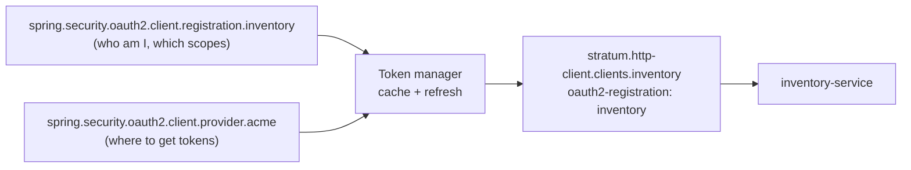

# OAuth2 client: `stratum-starter-oauth2-client`

**Status: Planned.** Obtains, caches and refreshes access tokens so your service can call other
secured services. Works hand in hand with the [HTTP client](http-client.md).

[← Documentation home](../README.md) · Property prefix: `stratum.oauth2-client`

## What it does

When `order-service` calls `inventory-service`, inventory expects an access token. There are two
common ways to get one:

| Flow | Use when | Token says |
| --- | --- | --- |
| **Client credentials** | Your service calls on its own behalf (a background job, a service-to-service call) | "I am order-service" |
| **Token relay** | Your service calls on behalf of the user who called you | "I am this user" (the incoming token is passed on) |

This starter handles the client credentials flow: it asks the identity provider for a token, caches
it, and refreshes it shortly before it expires. Token relay is a switch on the HTTP client and needs
no extra setup.

## Add it

```xml
<dependency>
  <groupId>com.exepex.stratum</groupId>
  <artifactId>stratum-starter-oauth2-client</artifactId>
</dependency>
```

The starter does nothing until you switch it on, in `application.properties`:

```properties
stratum.oauth2-client.enabled=true
```

or in `application.yml`:

```yaml
stratum:
  oauth2-client:
    enabled: true
```

## How it is configured

Client registrations use **Spring Security's standard properties**
(`spring.security.oauth2.client.*`). They are well documented and every Spring developer can read
them. Stratum adds safe defaults and connects a registration to an HTTP client by name.



## Examples

Order service calls inventory with its own token:

```yaml
spring:
  security:
    oauth2:
      client:
        provider:
          acme:
            issuer-uri: https://idp.acme.com/realms/acme
        registration:
          inventory:
            provider: acme
            authorization-grant-type: client_credentials
            client-id: order-service
            client-secret: ${INVENTORY_CLIENT_SECRET}   # from the environment, never in the file
            scope: inventory:read

stratum:
  http-client:
    clients:
      inventory:
        base-url: https://inventory.internal
        oauth2-registration: inventory
```

```properties
spring.security.oauth2.client.provider.acme.issuer-uri=https://idp.acme.com/realms/acme
spring.security.oauth2.client.registration.inventory.provider=acme
spring.security.oauth2.client.registration.inventory.authorization-grant-type=client_credentials
spring.security.oauth2.client.registration.inventory.client-id=order-service
spring.security.oauth2.client.registration.inventory.client-secret=${INVENTORY_CLIENT_SECRET}
spring.security.oauth2.client.registration.inventory.scope=inventory:read

stratum.http-client.clients.inventory.base-url=https://inventory.internal
stratum.http-client.clients.inventory.oauth2-registration=inventory
```

Every call through `InventoryClient` now carries `Authorization: Bearer <token>`. Your code does not
change.

Pass the user's own token on instead (token relay):

```yaml
stratum:
  http-client:
    clients:
      profile:
        base-url: https://profile.internal
        token-relay: true
```

```properties
stratum.http-client.clients.profile.base-url=https://profile.internal
stratum.http-client.clients.profile.token-relay=true
```

## What you get

| Feature | Behaviour | Bean type |
| --- | --- | --- |
| Token manager | Gets client credentials tokens, caches them per registration, refreshes before expiry | `OAuth2AuthorizedClientManager` |
| Thread-safe for high volume | One token request per registration at a time, however many threads need a token | Part of the manager |
| Timeouts | Token requests time out instead of blocking callers | Part of the manager |
| Metrics | Token request count, failures and latency per registration | Micrometer meters |

## Properties

Stratum's own properties tune the token handling. Registrations themselves use
`spring.security.oauth2.client.*` as shown above.

| Property | Type | Default | Description |
| --- | --- | --- | --- |
| `stratum.oauth2-client.enabled` | boolean | `false` | Switches the whole starter on. Until it is `true`, the starter sets up nothing. |
| `stratum.oauth2-client.refresh-before-expiry` | duration | `60s` | Fetch a new token this long before the old one expires. |
| `stratum.oauth2-client.token-request.connect-timeout` | duration | `2s` | Connect timeout towards the identity provider. |
| `stratum.oauth2-client.token-request.read-timeout` | duration | `5s` | Read timeout towards the identity provider. |
| `stratum.oauth2-client.token-request.retry-attempts` | int | `2` | Retries on network errors and `5xx` answers from the provider. |

On the HTTP client side (documented on the [HTTP client page](http-client.md#properties)):

| Property | Meaning |
| --- | --- |
| `stratum.http-client.clients.<name>.oauth2-registration` | Use this registration's client credentials token |
| `stratum.http-client.clients.<name>.token-relay` | Pass the incoming request's token on |

Set only one of the two per client. Setting both stops the startup with an error.

## Configure in Java

**Planned.** You will also be able to set every property on this page in Java code, through this module's
customizer or builder, with the same names and defaults. This section will show how once that API is designed.

## Customize

- **Different grant type** (for example JWT bearer or token exchange): declare your own
  `OAuth2AuthorizedClientProvider` bean; Stratum's manager uses it.
- **Different token storage** (for example shared across instances): declare your own
  `OAuth2AuthorizedClientService` bean.

## Switch it on or off

`stratum.oauth2-client.enabled=true` switches the starter on.
Leaving it unset is the same as `false`.

When it is off: HTTP clients that reference a registration then fail at
startup, so the problem is visible immediately.

## Troubleshooting

| Symptom | Likely cause and fix |
| --- | --- |
| `401` from the downstream service | Wrong `scope`, or the token's audience does not match what the downstream expects. Decode a token (in a safe environment) and compare. |
| `invalid_client` at the identity provider | Wrong `client-id` or `client-secret`, or the secret placeholder resolved to an empty value. |
| Startup fails with "registration not found" | The name in `oauth2-registration` does not match any `spring.security.oauth2.client.registration.<name>`. |
| Calls slow down every few minutes | Tokens are refreshed on the request path because `refresh-before-expiry` is too small for the provider's latency. Increase it. |
