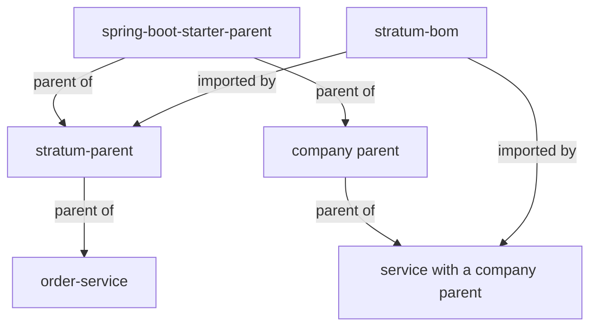

# Parent POM and BOM: `stratum-parent` and `stratum-bom`

**Status: Planned.** How your service gets Stratum's tested versions, Java settings and build checks.

[← Documentation home](../README.md) · How to choose between them: [Installation](../getting-started/installation.md)

## Why this matters

A Spring Boot service depends on hundreds of libraries. When each service picks versions on its own,
services drift apart, and upgrades turn into long investigations. Stratum tests one set of versions
together and publishes it in two forms:

| Artifact | What it is | Gives you |
| --- | --- | --- |
| `stratum-bom` | A *bill of materials*: a POM that lists versions only | Versions of Stratum's modules and of the extra libraries Stratum uses |
| `stratum-parent` | A parent POM that inherits Spring Boot's parent, imports the BOM and adds build settings | Spring Boot's versions, the BOM's versions, **plus** Java 25, plugin versions and quality checks |



Spring Boot's versions always come from the parent, never from the BOM. A service with
`stratum-parent` gets them from `spring-boot-starter-parent`; a service with a company parent gets
them from that parent. This way a service never receives two Spring Boot versions, and Stratum can be
used next to a company framework. The reasons are in
[ADR 0001](../adr/0001-coexistence-with-company-frameworks.md), and how to set it up is in
[Using Stratum with a company framework](../guides/company-framework.md).

## The BOM

The BOM manages versions of:

- every Stratum module,
- the extra libraries Stratum uses or recommends that Spring Boot does not manage (Resilience4j,
  cloud SDKs, and so on),
- the container images used in tests (as Maven properties).

It does **not** import Spring Boot's BOM (`spring-boot-dependencies`). If your parent does not
manage Spring Boot's versions, import `spring-boot-dependencies` yourself, at the version in the
[compatibility table](../guides/upgrading.md#compatibility). The two BOMs list different libraries,
so their order does not matter.

### The supported Spring Boot version

Each Stratum release supports one Spring Boot line, such as `4.1.x`. When your service starts,
Stratum checks the Spring Boot version that is running. If it is outside the supported line, the
service stops with a message that names both versions, so a mismatch is found on the first start
and not in production.

### Overriding one managed version

How you override a version depends on who manages the library.

**A library Spring Boot manages**, such as the PostgreSQL driver: set Spring Boot's version
property. This works with `stratum-parent` and with any parent that extends
`spring-boot-starter-parent`:

```xml
<properties>
  <postgresql.version>X.Y.Z</postgresql.version> <!-- the patched version -->
</properties>
```

**A library `stratum-bom` manages**, such as Resilience4j: a property does **not** work, because
Maven resolves the BOM's properties before importing it. Declare the dependency in your own
`dependencyManagement`. A version you declare in your own POM wins over every inherited or imported
one. With a BOM import, put it above the import to make that clear to readers:

```xml
<dependencyManagement>
  <dependencies>
    <dependency>
      <groupId>io.github.resilience4j</groupId>
      <artifactId>resilience4j-circuitbreaker</artifactId>
      <version>X.Y.Z</version> <!-- the patched version -->
    </dependency>
    <dependency>
      <groupId>com.example.stratum</groupId>
      <artifactId>stratum-bom</artifactId>
      <version>0.1.0-SNAPSHOT</version>
      <type>pom</type>
      <scope>import</scope>
    </dependency>
  </dependencies>
</dependencyManagement>
```

> [!NOTE]
> With a company parent, a library that both the company parent and `stratum-bom` manage gets the
> company parent's version: Maven lets versions inherited from a parent win over versions imported
> from a BOM, without a warning. See
> [Using Stratum with a company framework](../guides/company-framework.md#rule-1-one-spring-boot-version-set-by-the-parent).

> [!WARNING]
> An overridden version is no longer tested with the rest. Do it only for an urgent security fix,
> and remove the override at the next Stratum upgrade.

## The parent POM

On top of Spring Boot's parent and the BOM, `stratum-parent` sets:

| Area | Setting |
| --- | --- |
| Java | `maven.compiler.release=25`, `-parameters`, UTF-8 everywhere |
| Plugin versions | Compiler, Surefire, Failsafe, JaCoCo, Spotless, Checkstyle, PMD, SpotBugs, Enforcer, Spring Boot plugin |
| Tests | `*Test.java` run by Surefire in `mvn test`; `*IT.java` run by Failsafe in `mvn verify` |
| Formatting | Spotless checks Google Java Format; `mvn spotless:apply` fixes it |
| Static analysis | Checkstyle, PMD and SpotBugs with Stratum's shared rule sets |
| Enforcer | Requires JDK 25 and Maven 3.9+, bans duplicate classes and known-bad dependencies |
| Build info | `/actuator/info` shows the build version, time and Git commit |
| Packaging | `spring-boot-maven-plugin` builds an executable jar; `mvn spring-boot:build-image` builds a container image |

### Build checks your service gets

| Phase | Command | Checks |
| --- | --- | --- |
| validate | `mvn validate` | Formatting, Checkstyle, Enforcer rules |
| test | `mvn test` | Unit and slice tests |
| verify | `mvn verify` | Integration tests, PMD, SpotBugs, coverage report |

### Optional profiles

| Profile | Command | Adds |
| --- | --- | --- |
| `coverage-gate` | `mvn verify -Pcoverage-gate` | Fails the build below the coverage threshold |
| `security` | `mvn verify -Psecurity` | Scans dependencies for known vulnerabilities |

### Tuning the checks

A property a service may set in its own `pom.xml` (it can raise the bar, never lower it below Stratum's minimum):

| Maven property | Default | Meaning |
| --- | --- | --- |
| `stratum.coverage.minimum` | `0.80` | Line coverage required by `coverage-gate` |

## Upgrading

Change the version of `stratum-parent` (or `stratum-bom`) in one place and run `mvn verify`. Read the
release notes first; see [Versioning and upgrades](../guides/upgrading.md).
