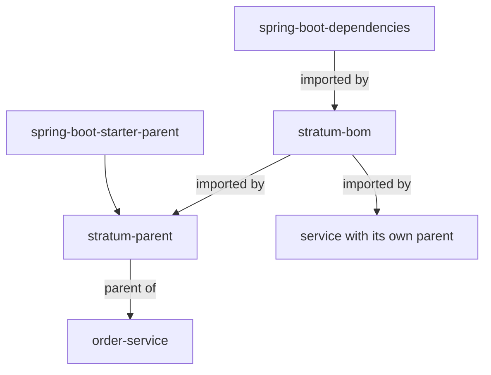

# Parent POM and BOM: `stratum-parent` and `stratum-bom`

**Status: Planned.** How your service gets Stratum's tested versions, Java settings and build checks.

[← Documentation home](../README.md) · How to choose between them: [Installation](../getting-started/installation.md)

## Why this matters

A Spring Boot service depends on hundreds of libraries. When each service picks versions on its own,
services drift apart, and upgrades turn into long investigations. Stratum tests one set of versions
together and publishes it in two forms:

| Artifact | What it is | Gives you |
| --- | --- | --- |
| `stratum-bom` | A *bill of materials*: a POM that lists versions only | Dependency versions |
| `stratum-parent` | A parent POM that imports the BOM and adds build settings | Dependency versions **plus** Java 25, plugin versions and quality checks |



## The BOM

The BOM manages versions of:

- every Stratum module,
- Spring Boot and everything Spring Boot manages (it imports Spring Boot's BOM),
- the extra libraries Stratum uses or recommends (Resilience4j, Testcontainers modules, cloud SDKs,
  and so on),
- the container images used in tests (as Maven properties).

You can override one managed version. How depends on how your service uses Stratum.

**With `stratum-parent`:** set the version property, as with Spring Boot's parent:

```xml
<properties>
  <postgresql.version>X.Y.Z</postgresql.version> <!-- the patched version -->
</properties>
```

**With the BOM import:** a property does **not** work, because Maven resolves the BOM's properties
before importing it. Declare the dependency in your own `dependencyManagement`, **above** the BOM
import (the first declaration wins):

```xml
<dependencyManagement>
  <dependencies>
    <dependency>
      <groupId>org.postgresql</groupId>
      <artifactId>postgresql</artifactId>
      <version>X.Y.Z</version> <!-- the patched version -->
    </dependency>
    <dependency>
      <groupId>com.example.stratum</groupId>
      <artifactId>stratum-bom</artifactId>
      <version>0.1.0-SNAPSHOT</version>
      <type>pom</type>
      <scope>import</scope>
    </dependency>
  </dependencies>
</dependencyManagement>
```

> [!WARNING]
> An overridden version is no longer tested with the rest. Do it only for an urgent security fix,
> and remove the override at the next Stratum upgrade.

## The parent POM

On top of the BOM, `stratum-parent` sets:

| Area | Setting |
| --- | --- |
| Java | `maven.compiler.release=25`, `-parameters`, UTF-8 everywhere |
| Plugin versions | Compiler, Surefire, Failsafe, JaCoCo, Spotless, Checkstyle, PMD, SpotBugs, Enforcer, Spring Boot plugin |
| Tests | `*Test.java` run by Surefire in `mvn test`; `*IT.java` run by Failsafe in `mvn verify` |
| Formatting | Spotless checks Google Java Format; `mvn spotless:apply` fixes it |
| Static analysis | Checkstyle, PMD and SpotBugs with Stratum's shared rule sets |
| Enforcer | Requires JDK 25 and Maven 3.9+, bans duplicate classes and known-bad dependencies |
| Build info | `/actuator/info` shows the build version, time and Git commit |
| Packaging | `spring-boot-maven-plugin` builds an executable jar; `mvn spring-boot:build-image` builds a container image |

### Build checks your service gets

| Phase | Command | Checks |
| --- | --- | --- |
| validate | `mvn validate` | Formatting, Checkstyle, Enforcer rules |
| test | `mvn test` | Unit and slice tests |
| verify | `mvn verify` | Integration tests, PMD, SpotBugs, coverage report |

### Optional profiles

| Profile | Command | Adds |
| --- | --- | --- |
| `coverage-gate` | `mvn verify -Pcoverage-gate` | Fails the build below the coverage threshold |
| `security` | `mvn verify -Psecurity` | Scans dependencies for known vulnerabilities |

### Tuning the checks

A property a service may set in its own `pom.xml` (it can raise the bar, never lower it below Stratum's minimum):

| Maven property | Default | Meaning |
| --- | --- | --- |
| `stratum.coverage.minimum` | `0.80` | Line coverage required by `coverage-gate` |

## Upgrading

Change the version of `stratum-parent` (or `stratum-bom`) in one place and run `mvn verify`. Read the
release notes first; see [Versioning and upgrades](../guides/upgrading.md).
