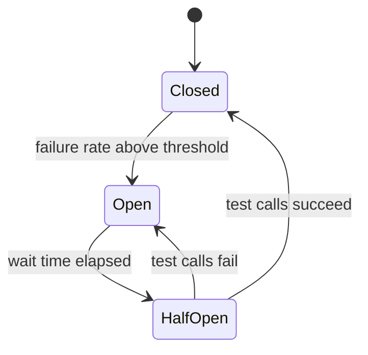

# Resilience: `stratum-starter-resilience`

**Status: Planned.** Named policies for retries, circuit breakers, bulkheads and time limits, so a
failing dependency slows one feature down instead of taking the whole service with it.

[← Documentation home](../README.md) · Property prefix: `stratum.resilience`

## What it does

| Pattern | Problem it solves | In one line |
| --- | --- | --- |
| **Retry** | A call fails once because of a brief network glitch | Try again a few times, waiting longer each time |
| **Circuit breaker** | A dependency is down and every call waits for a timeout | After many failures, fail immediately for a while, then test again |
| **Bulkhead** | One slow dependency uses up all threads | Limit how many calls to it can run at once |
| **Time limit** | An operation takes far too long | Give up after a fixed time |

You define these as **policies** with a name in configuration and apply a policy by name: to an HTTP
client in properties, or to any method with an annotation. The implementation uses
[Resilience4j](https://resilience4j.readme.io/), with Stratum's defaults and metrics.



*Circuit breaker states: **Closed** lets calls through, **Open** rejects them at once, **Half-open**
lets a few test calls through.*

## Add it

```xml
<dependency>
  <groupId>com.exepex.stratum</groupId>
  <artifactId>stratum-starter-resilience</artifactId>
</dependency>
```

The starter does nothing until you switch it on, in `application.properties`:

```properties
stratum.resilience.enabled=true
```

or in `application.yml`:

```yaml
stratum:
  resilience:
    enabled: true
```

## Use it

**On an HTTP client** (no code): every client uses the `default` policy, or the one you name:

```yaml
spring:
  http:
    serviceclient:
      payments:
        base-url: https://payments.internal

stratum:
  http-client:
    clients:
      payments:
        resilience-policy: payments
```

```properties
spring.http.serviceclient.payments.base-url=https://payments.internal
stratum.http-client.clients.payments.resilience-policy=payments
```

**On any method**, with Resilience4j's annotations; the `name` is the policy name:

```java
@Service
class ExchangeRateService {

  @CircuitBreaker(name = "rates", fallbackMethod = "lastKnownRate")
  @Retry(name = "rates")
  BigDecimal rate(String currency) {
    return ratesClient.current(currency);
  }

  private BigDecimal lastKnownRate(String currency, Throwable cause) {
    return rateCache.lastKnown(currency);
  }
}
```

## Retries are only safe for some operations

> [!WARNING]
> Retry only **idempotent** operations: ones that have the same effect whether they run once or
> several times. `GET`, `PUT` and `DELETE` usually are; `POST` usually is not. Retrying "charge the
> card" can charge the customer twice.

Stratum's default policy therefore retries only `GET`, `HEAD`, `OPTIONS`, `PUT` and `DELETE` calls,
and only on failures that are likely to be temporary: connection errors, timeouts, `502`, `503` and
`504`. It never retries `4xx` answers.

## Properties

Policies live under `stratum.resilience.policies.<name>`. The `default` policy always exists;
every other policy starts from `default` and overrides what it sets.

| Property (under `stratum.resilience.policies.<name>.`) | Type | Default | Description |
| --- | --- | --- | --- |
| `retry.enabled` | boolean | `true` | Retries failed calls. |
| `retry.max-attempts` | int | `3` | Total attempts, including the first. |
| `retry.initial-backoff` | duration | `200ms` | Wait before the first retry. |
| `retry.multiplier` | number | `2.0` | Each wait is this many times the previous one. |
| `retry.max-backoff` | duration | `2s` | Upper limit for one wait. |
| `retry.jitter` | number 0.0–1.0 | `0.5` | Random spread on waits, so many instances do not retry in step. |
| `retry.retry-on-status` | list | `502`, `503`, `504` | HTTP statuses that are retried. |
| `circuit-breaker.enabled` | boolean | `true` | Uses a circuit breaker. |
| `circuit-breaker.failure-rate-threshold` | percent | `50` | Opens when this share of recent calls failed. |
| `circuit-breaker.slow-call-threshold` | duration | `3s` | Calls slower than this count as slow. |
| `circuit-breaker.slow-call-rate-threshold` | percent | `80` | Opens when this share of recent calls was slow. |
| `circuit-breaker.sliding-window-size` | int | `50` | Number of recent calls looked at. |
| `circuit-breaker.minimum-calls` | int | `20` | Calls needed before the rate is judged. |
| `circuit-breaker.wait-in-open-state` | duration | `30s` | Time in Open before testing again. |
| `circuit-breaker.half-open-calls` | int | `5` | Test calls allowed in Half-open. |
| `bulkhead.enabled` | boolean | `false` | Limits concurrent calls. |
| `bulkhead.max-concurrent-calls` | int | `25` | Calls allowed at once. |
| `bulkhead.max-wait` | duration | `0ms` | Time a call waits for a free slot before being rejected. |
| `time-limit.enabled` | boolean | `false` | Limits total time per call, including retries. |
| `time-limit.timeout` | duration | `10s` | The limit. |

| Property | Type | Default | Description |
| --- | --- | --- | --- |
| `stratum.resilience.enabled` | boolean | `false` | Switches the whole starter on. Until it is `true`, the starter sets up nothing. |

## Examples

A careful policy for payments (no retries, early circuit breaking) and a relaxed one for rates:

```yaml
stratum:
  resilience:
    policies:
      payments:
        retry:
          enabled: false
        circuit-breaker:
          failure-rate-threshold: 25
          wait-in-open-state: 60s
        bulkhead:
          enabled: true
          max-concurrent-calls: 10
      rates:
        retry:
          max-attempts: 5
          max-backoff: 5s
```

```properties
stratum.resilience.policies.payments.retry.enabled=false
stratum.resilience.policies.payments.circuit-breaker.failure-rate-threshold=25
stratum.resilience.policies.payments.circuit-breaker.wait-in-open-state=60s
stratum.resilience.policies.payments.bulkhead.enabled=true
stratum.resilience.policies.payments.bulkhead.max-concurrent-calls=10
stratum.resilience.policies.rates.retry.max-attempts=5
stratum.resilience.policies.rates.retry.max-backoff=5s
```

## Watching it work

Each policy publishes metrics (`resilience4j.circuitbreaker.state`, `resilience4j.retry.calls`, and
others) tagged with the policy name, and logs every circuit breaker state change at `WARN`. Add the
circuit breaker state to your service dashboard: an Open breaker is an early warning.

## Configure in Java

**Planned.** You will also be able to set every property on this page in Java code, through this module's
customizer or builder, with the same names and defaults. This section will show how once that API is designed.

## Customize

- **Different failure rules:** declare a `CircuitBreakerConfigCustomizer` or `RetryConfigCustomizer`
  bean for a policy name.
- **Resilience4j properties:** `resilience4j.*` properties still work and win over Stratum's values
  for the same instance name.

## Switch it on or off

`stratum.resilience.enabled=true` switches the starter on.
Leaving it unset is the same as `false`.

`stratum.resilience.enabled=false` removes all policies; HTTP clients then make single attempts with
only their timeouts. To switch off one client only, set its `resilience-policy: none`.

## Troubleshooting

| Symptom | Likely cause and fix |
| --- | --- |
| `CallNotPermittedException` | The circuit breaker is Open. Look at why the downstream fails; do not just raise the threshold. |
| A `POST` was not retried | Intended: `POST` is not idempotent. If your endpoint is idempotent (for example it takes an idempotency key), use the annotation on your method. |
| Annotation has no effect | The method is called from the same class (Spring proxies are bypassed) or is `private`. Move it to another bean. |
| Calls take much longer than the timeout | Retries multiply the time: 3 attempts × 5 s plus backoff. Use `time-limit` to cap the total. |
