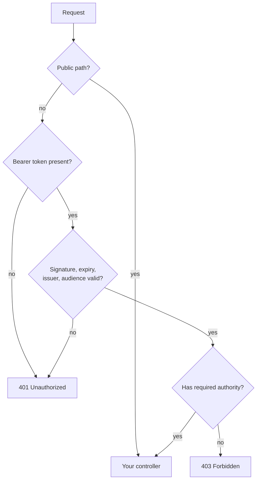

# Security: `stratum-starter-security`

**Status: Planned.** Protects your API with OAuth2 access tokens (JWTs). You give the issuer of the
tokens; Stratum builds the security rules, the token validation and the `401`/`403` responses.

[← Documentation home](../README.md) · Property prefix: `stratum.security`

## What it does

In a microservices platform, an identity provider (Keycloak, Okta, Auth0, Entra ID, Cognito, ...)
issues **access tokens**. Each service checks the token on every request: is it signed by the
provider, not expired, meant for this service, and does it grant what the caller asks for? A service
that does this is an **OAuth2 resource server**.

Writing this by hand in Spring Security takes a `SecurityFilterChain`, a JWT decoder, audience
checks and an authority mapper, and is easy to get subtly wrong. This starter does it from a few
properties, the same way in every service.

## Add it

```xml
<dependency>
  <groupId>com.example.stratum</groupId>
  <artifactId>stratum-starter-security</artifactId>
</dependency>
```

**Required setting:** `stratum.security.resource-server.issuer-uri`. The service does not start
without it, so it can never run unprotected by accident.

## What you get

| Feature | Behaviour | Bean type |
| --- | --- | --- |
| Every request needs a valid token | Except the [public paths](#properties) | `SecurityFilterChain` |
| Token validation | Signature (keys fetched from the issuer and cached), expiry, issuer and audience | `JwtDecoder` |
| Roles from the token | Scopes or a roles claim become Spring authorities | `JwtAuthenticationConverter` |
| Stateless | No HTTP session, CSRF off (correct for token-based APIs) | Part of the chain |
| Error responses | `401` and `403` in the standard Problem Details format | `AuthenticationEntryPoint`, `AccessDeniedHandler` |
| CORS | Off unless you list allowed origins | `CorsConfigurationSource` |
| Security headers | `X-Content-Type-Options`, `Strict-Transport-Security`, `Cache-Control: no-store` | Part of the chain |

### How a request is checked



### Checking permissions in your code

Stratum switches on method security, so you protect endpoints with annotations:

```java
@RestController
@RequestMapping("/orders")
class OrderController {

  @GetMapping("/{id}")
  @PreAuthorize("hasAuthority('SCOPE_orders:read')")
  OrderView get(@PathVariable String id) { ... }

  @PostMapping
  @PreAuthorize("hasAuthority('SCOPE_orders:write')")
  OrderView create(@RequestBody CreateOrder request) { ... }
}
```

Read the caller's identity when you need it:

```java
@GetMapping("/me/orders")
List<OrderView> mine(@AuthenticationPrincipal Jwt jwt) {
  return orders.forCustomer(jwt.getSubject());
}
```

## Properties

| Property | Type | Default | Description |
| --- | --- | --- | --- |
| `stratum.security.enabled` | boolean | `true` | Switches the whole starter on or off. |
| `stratum.security.resource-server.issuer-uri` | URI | **required** | Issuer of the tokens, e.g. `https://idp.acme.com/realms/acme`. Keys are discovered from it. |
| `stratum.security.resource-server.jwk-set-uri` | URI | *(discovered)* | Set only if the issuer does not publish discovery metadata. |
| `stratum.security.resource-server.audiences` | list | *(empty: not checked)* | Accepted `aud` values. Set it, so tokens meant for other services are rejected. |
| `stratum.security.resource-server.authorities-claim` | string | `scope` | Claim that holds the caller's permissions, e.g. `scope`, `roles`, `realm_access.roles`. |
| `stratum.security.resource-server.authority-prefix` | string | `SCOPE_` | Prefix added to each value; use `ROLE_` with `hasRole(...)`. |
| `stratum.security.resource-server.clock-skew` | duration | `30s` | Tolerance for clock differences when checking expiry. |
| `stratum.security.public-paths` | list | `/actuator/health/**`, `/actuator/info` | Paths that need no token. |
| `stratum.security.cors.allowed-origins` | list | *(empty: CORS off)* | Browser origins allowed to call the API. |
| `stratum.security.cors.allowed-methods` | list | `GET`, `POST`, `PUT`, `PATCH`, `DELETE` | Methods allowed for those origins. |
| `stratum.security.cors.allowed-headers` | list | `Authorization`, `Content-Type`, `X-Correlation-Id` | Request headers allowed. |
| `stratum.security.cors.max-age` | duration | `30m` | How long browsers cache the CORS answer. |

## Examples

Keycloak, with audience checking and roles from the realm:

```yaml
stratum:
  security:
    resource-server:
      issuer-uri: https://idp.acme.com/realms/acme
      audiences:
        - order-service
      authorities-claim: realm_access.roles
      authority-prefix: ROLE_
    public-paths:
      - /actuator/health/**
      - /actuator/info
      - /v3/api-docs/**
```

```properties
stratum.security.resource-server.issuer-uri=https://idp.acme.com/realms/acme
stratum.security.resource-server.audiences=order-service
stratum.security.resource-server.authorities-claim=realm_access.roles
stratum.security.resource-server.authority-prefix=ROLE_
stratum.security.public-paths=/actuator/health/**,/actuator/info,/v3/api-docs/**
```

A browser front end on another domain:

```yaml
stratum:
  security:
    cors:
      allowed-origins:
        - https://shop.acme.com
```

```properties
stratum.security.cors.allowed-origins=https://shop.acme.com
```

> [!NOTE]
> Changing `public-paths` replaces the whole default list. Keep the health paths in it, or
> Kubernetes probes start failing with `401`.

## Customize

- **Add rules without losing Stratum's:** declare a `StratumSecurityCustomizer`. It receives
  `HttpSecurity` before the catch-all "authenticated" rule is added:

  ```java
  @Bean
  StratumSecurityCustomizer opsEndpoints() {
    return http -> http.authorizeHttpRequests(auth -> auth
        .requestMatchers("/internal/**").hasRole("OPS"));
  }
  ```

- **Different claim mapping:** declare your own `JwtAuthenticationConverter` bean.
- **Full control:** declare your own `SecurityFilterChain`. Stratum's chain then steps aside (see
  [Overriding defaults](../configuration/overriding-defaults.md#level-3-replace-a-bean)).

## Switch it off

`stratum.security.enabled=false` removes Stratum's chain. Because Spring Security stays on the
classpath, Spring Boot's own default (HTTP Basic with a generated password) applies instead. To run
truly without security, remove the starter.

## Testing secured endpoints

`stratum-test` gives you a test JWT in one call, so you never need a real identity provider in tests:

```java
mvc.get().uri("/orders/42").with(stratumJwt("orders:read"))
```

See [Testing](test.md#testing-secured-endpoints).

## Troubleshooting

| Symptom | Likely cause and fix |
| --- | --- |
| Every request returns `401` | Wrong `issuer-uri` (must match the token's `iss` claim exactly, including trailing `/`), or the issuer is not reachable from the service at startup. |
| `401` with "audience" in the log | The token's `aud` does not contain any of `audiences`. Fix the client's token request or the list. |
| `403` although the user has the role | Check `authorities-claim` and `authority-prefix`; `hasRole('X')` expects `ROLE_X`. Enable `logging.level.org.springframework.security=DEBUG` in a safe environment. |
| Health probes return `401` | `public-paths` was replaced without keeping `/actuator/health/**`. |
| Browser shows a CORS error | Add the front end's exact origin (scheme, host and port) to `cors.allowed-origins`. |
