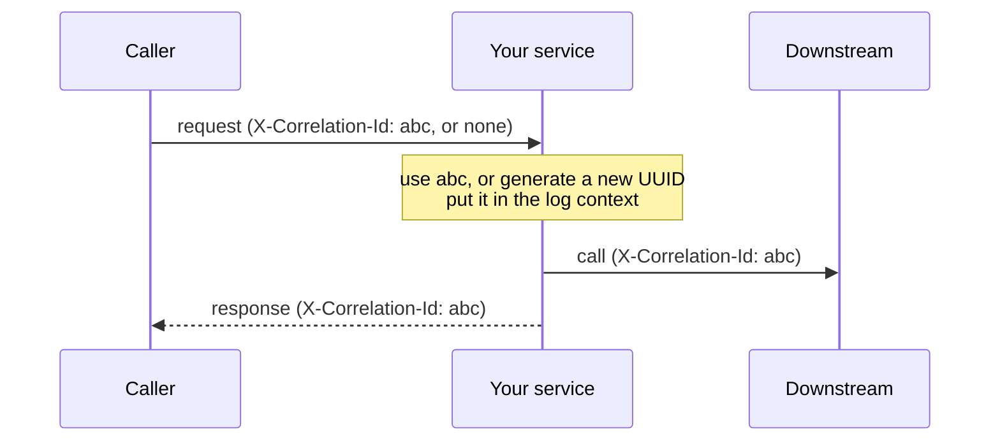

# Web: `stratum-starter-web`

**Status: Planned.** REST API defaults that every Stratum service shares: one error format,
correlation IDs, request logging, validation and JSON settings.

[← Documentation home](../README.md) · Property prefix: `stratum.web`

## What it does

Without this starter each service decides for itself what an error looks like, whether requests
carry an ID and how JSON is written. Clients of your API then need special handling per service.
With it, every service answers the same way.

## Add it

```xml
<dependency>
  <groupId>com.example.stratum</groupId>
  <artifactId>stratum-starter-web</artifactId>
</dependency>
```

It brings Spring MVC (servlet stack, embedded Tomcat) and Jakarta Bean Validation. Do not add
`spring-boot-starter-web` or `spring-boot-starter-webmvc` as well.

## What you get

| Feature | Behaviour | Bean type |
| --- | --- | --- |
| Error responses | Every error is [RFC 9457 Problem Details](https://www.rfc-editor.org/rfc/rfc9457) JSON with `traceId` and `correlationId` added | `StratumExceptionHandler` (`@RestControllerAdvice`) |
| Validation errors | `400` with one entry per invalid field | Part of the exception handler |
| Correlation ID | Read from the request header or generated, stored in the log context, returned in the response | `CorrelationIdFilter` |
| Request logging | One log line per request: method, path, status, duration | `RequestLoggingFilter` |
| JSON | ISO-8601 dates, unknown fields ignored, `null` fields left out | `JsonMapperBuilderCustomizer` |

### The error format

Every error, whether thrown by your code, by validation or by Spring, looks like this:

```json
{
  "type": "about:blank",
  "title": "Bad Request",
  "status": 400,
  "detail": "Validation failed for 2 fields",
  "instance": "/orders",
  "traceId": "4bf92f3577b34da6a3ce929d0e0e4736",
  "correlationId": "c0a8012e-7f3d-4a8e-9a43-2f9b6f1c2d10",
  "errors": [
    { "field": "sku", "message": "must not be blank" },
    { "field": "quantity", "message": "must be greater than 0" }
  ]
}
```

| Your code throws | Status returned |
| --- | --- |
| `ErrorResponseException` (Spring) or a subclass | The status it carries |
| Exception annotated `@ResponseStatus(...)` | That status |
| `MethodArgumentNotValidException`, `ConstraintViolationException` | `400`, with `errors` |
| `AccessDeniedException` / missing or invalid token | `403` / `401` (with the security starter) |
| Downstream timeout or connection failure (with the http-client starter) | `503` or `504` |
| Anything else | `500`, with a generic `detail`; the real message and stack trace go to the log only |

Internal details such as stack traces, SQL or class names are **never** sent to the caller.

### How correlation IDs work



The correlation ID is separate from the trace ID: it can be set by a caller outside your tracing
system (a partner, a mobile app) and still be found in every log line.

## Properties

| Property | Type | Default | Description |
| --- | --- | --- | --- |
| `stratum.web.enabled` | boolean | `true` | Switches the whole starter on or off. |
| `stratum.web.correlation.enabled` | boolean | `true` | Handles correlation IDs. |
| `stratum.web.correlation.header` | string | `X-Correlation-Id` | Header that carries the ID in and out. |
| `stratum.web.correlation.generate-if-missing` | boolean | `true` | Creates an ID when the request has none. |
| `stratum.web.correlation.return-in-response` | boolean | `true` | Adds the ID to the response headers. |
| `stratum.web.error.type-base-uri` | URI | `about:blank` | Base URI for the Problem Details `type` field, e.g. `https://errors.acme.com/`. |
| `stratum.web.error.include-trace-id` | boolean | `true` | Adds `traceId` to error bodies. |
| `stratum.web.error.include-correlation-id` | boolean | `true` | Adds `correlationId` to error bodies. |
| `stratum.web.request-logging.enabled` | boolean | `true` | Logs one line per request. |
| `stratum.web.request-logging.include-query-string` | boolean | `false` | Adds the query string to the line (redacted). |
| `stratum.web.request-logging.slow-threshold` | duration | `2s` | Requests slower than this are logged at `WARN`. |
| `stratum.web.request-logging.exclude-paths` | list | `/actuator/**` | Paths that are never logged. |
| `stratum.web.json.include-nulls` | boolean | `false` | Writes fields whose value is `null`. |
| `stratum.web.json.fail-on-unknown-properties` | boolean | `false` | Rejects requests with unknown JSON fields. |

Spring Boot properties this starter sets by default (your values win):

| Spring Boot property | Stratum default |
| --- | --- |
| `spring.mvc.problemdetails.enabled` | `true` |
| `server.error.include-stacktrace` | `never` |
| `server.error.include-message` | `never` |
| `server.shutdown` | `graceful` |

## Examples

Use your own error catalogue URI and a different correlation header:

```yaml
stratum:
  web:
    correlation:
      header: X-Request-Id
    error:
      type-base-uri: https://errors.acme.com/
    request-logging:
      slow-threshold: 500ms
      exclude-paths:
        - /actuator/**
        - /favicon.ico
```

```properties
stratum.web.correlation.header=X-Request-Id
stratum.web.error.type-base-uri=https://errors.acme.com/
stratum.web.request-logging.slow-threshold=500ms
stratum.web.request-logging.exclude-paths=/actuator/**,/favicon.ico
```

Throw a business error with its own type and status:

```java
class OutOfStockException extends ErrorResponseException {

  OutOfStockException(String sku) {
    super(HttpStatus.CONFLICT, problem(sku), null);
  }

  private static ProblemDetail problem(String sku) {
    var problem = ProblemDetail.forStatusAndDetail(HttpStatus.CONFLICT, "Not enough stock for " + sku);
    problem.setType(URI.create("https://errors.acme.com/out-of-stock"));
    problem.setProperty("sku", sku);
    return problem;
  }
}
```

## Configure in Java

**Planned.** You will also be able to set every property on this page in Java code, through this module's
customizer or builder, with the same names and defaults. This section will show how once that API is designed.

## Customize

- **Add a field to every error body:** declare a `StratumErrorResponseCustomizer` bean.
- **Handle one exception type yourself:** write a normal `@ExceptionHandler` in your own
  `@RestControllerAdvice`. Yours runs before Stratum's, which handles only what is left.
- **Change JSON settings:** declare a `JsonMapperBuilderCustomizer` bean, or use Spring Boot's
  `spring.jackson.*` properties.

See [Overriding defaults](../configuration/overriding-defaults.md).

## Switch it off

`stratum.web.enabled=false` removes Stratum's handler, filters and JSON settings. Spring MVC itself
stays.

## Troubleshooting

| Symptom | Likely cause and fix |
| --- | --- |
| Errors come back as HTML or Spring's default JSON | Another `@RestControllerAdvice` handles everything first. Narrow it to the exceptions it really owns. |
| No correlation ID in logs | `stratum-starter-logging` is missing, or `stratum.web.correlation.enabled=false`. |
| A request field is silently ignored | Unknown fields are ignored by default. Set `stratum.web.json.fail-on-unknown-properties=true` to reject them. |
